<picture>
  <source media="(prefers-color-scheme: dark)" srcset="assets/hero-dark.svg">
  
</picture>

  
  

<picture>
  <source media="(prefers-color-scheme: dark)" srcset="assets/numbers-dark.svg">
  
</picture>

<picture>
  <source media="(prefers-color-scheme: dark)" srcset="assets/track-dark.svg">
  
</picture>

<picture>
  <source media="(prefers-color-scheme: dark)" srcset="assets/projects-dark.svg">
  
</picture>

<picture>
  <source media="(prefers-color-scheme: dark)" srcset="assets/activity-dark.svg">
  
</picture>

### Contributions

<!-- contributions:start -->
| Project | Pull request | Status | Lines |
|---|---|---|---|
| [code-yeongyu/oh-my-openagent](https://github.com/code-yeongyu/oh-my-openagent) | [#12270](https://github.com/code-yeongyu/oh-my-openagent/pull/12270) Publish the memory footer once per session bind | In review | +225 −10 |
| [code-yeongyu/oh-my-openagent](https://github.com/code-yeongyu/oh-my-openagent) | [#12262](https://github.com/code-yeongyu/oh-my-openagent/pull/12262) Isolate four HOME-dependent tests from the host's real home directory | In review | +20 −5 |
| [pingdotgg/t3code](https://github.com/pingdotgg/t3code) | [#29511](https://github.com/pingdotgg/t3code/pull/29511) Typeset equations that fail only because of an unescaped percent | In review | +33 −12 |
| [debpalash/VoiceStudio](https://github.com/debpalash/VoiceStudio) | [#3727](https://github.com/debpalash/VoiceStudio/pull/3727) Explain backend exit code 4294967295 as an external termination | Merged | +265 −84 |
| [debpalash/VoiceStudio](https://github.com/debpalash/VoiceStudio) | [#3724](https://github.com/debpalash/VoiceStudio/pull/3724) Diagnose silent backend startup timeouts with the backend log tail | Merged | +200 −9 |
| [code-yeongyu/oh-my-openagent](https://github.com/code-yeongyu/oh-my-openagent) | [#11863](https://github.com/code-yeongyu/oh-my-openagent/pull/11863) Machine-unique identity for the reflection lock host check | In review | +288 −10 |
<!-- contributions:end -->

Rebuilt daily from GitHub. A pull request counts as merged once its code is in a project's main branch.

### Contact

[meutex.com](https://meutex.com) · [admin@meutex.com](mailto:admin@meutex.com)
