<picture>
  <source media="(prefers-color-scheme: dark)" srcset="assets/hero-dark.svg">
  
</picture>

  
  

<picture>
  <source media="(prefers-color-scheme: dark)" srcset="assets/now-dark.svg">
  
</picture>

<!-- contributions:start -->
### Merged

**[milind-soni/OpenMausBot](https://github.com/milind-soni/OpenMausBot)**

- [#5846](https://github.com/milind-soni/OpenMausBot/pull/5846) fix(login-fill): find sign-in fields inside open shadow roots  
  merged in 1 day · +111 −13
- [#5836](https://github.com/milind-soni/OpenMausBot/pull/5836) Match the stored attachment source when a bot's file link resolves the d  
  merged in 1 day · +69 −10

**[debpalash/VoiceStudio](https://github.com/debpalash/VoiceStudio)**

- [#3727](https://github.com/debpalash/VoiceStudio/pull/3727) Explain backend exit code 4294967295 as an external termination  
  shipped through a maintainer's merge · +265 −84
- [#3724](https://github.com/debpalash/VoiceStudio/pull/3724) Diagnose silent backend startup timeouts with the backend log tail  
  merged in 7 days · +200 −9

**[pingdotgg/t3code](https://github.com/pingdotgg/t3code)**

- [#29511](https://github.com/pingdotgg/t3code/pull/29511) Typeset equations that fail only because of an unescaped percent  
  merged in 10 days · 7 reviews · +33 −12

### In review

- [AnkurKumarShukla/CareConnect #32](https://github.com/AnkurKumarShukla/CareConnect/pull/32) fix: Add scripts/check-env.sh to verify TESTDBURL is configured  
  open since Nov 26 · +10 −0
- [vercel-labs/agent-browser #2609](https://github.com/vercel-labs/agent-browser/pull/2609) Keep proxy credentials out of the daemon environment  
  open since Nov 15 · +162 −34
- [code-yeongyu/oh-my-openagent #12270](https://github.com/code-yeongyu/oh-my-openagent/pull/12270) Publish the memory footer once per session bind  
  open since Nov 03 · +225 −10
- [code-yeongyu/oh-my-openagent #12262](https://github.com/code-yeongyu/oh-my-openagent/pull/12262) Isolate four HOME-dependent tests from the host's real home directory  
  open since Nov 03 · +20 −5
- [code-yeongyu/oh-my-openagent #11863](https://github.com/code-yeongyu/oh-my-openagent/pull/11863) Machine-unique identity for the reflection lock host check  
  open since Oct 30 · +288 −10
<!-- contributions:end -->

### How I work

- Reproduce the bug before changing anything.
- One problem per pull request, kept small enough to review quickly.
- Agree on scope in the issue before a large change.
- Follow the project's own contributing guide and code style.

<picture>
  <source media="(prefers-color-scheme: dark)" srcset="assets/activity-dark.svg">
  
</picture>

<picture>
  <source media="(prefers-color-scheme: dark)" srcset="assets/languages-dark.svg">
  
</picture>

<!-- footer:start -->
5 merged into 3 projects · 5 in review · rebuilt daily from GitHub. A pull request counts as merged once its code is in a project's main branch, including through a maintainer's pull request that credits me as co-author.
<!-- footer:end -->
